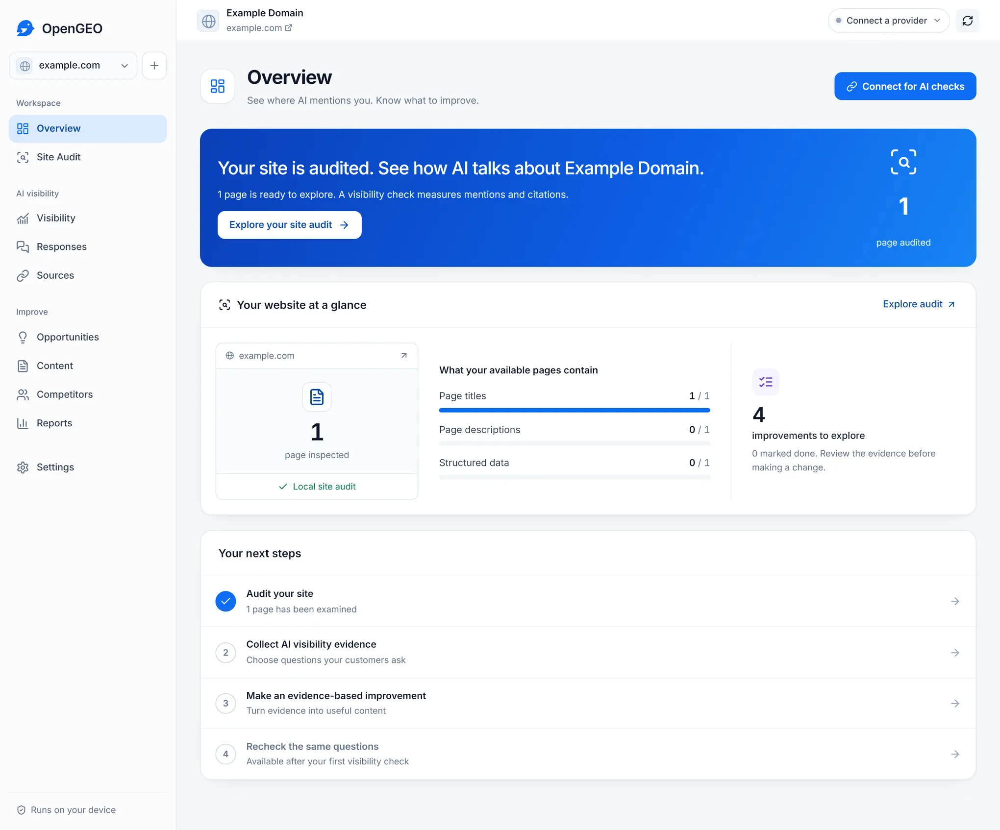
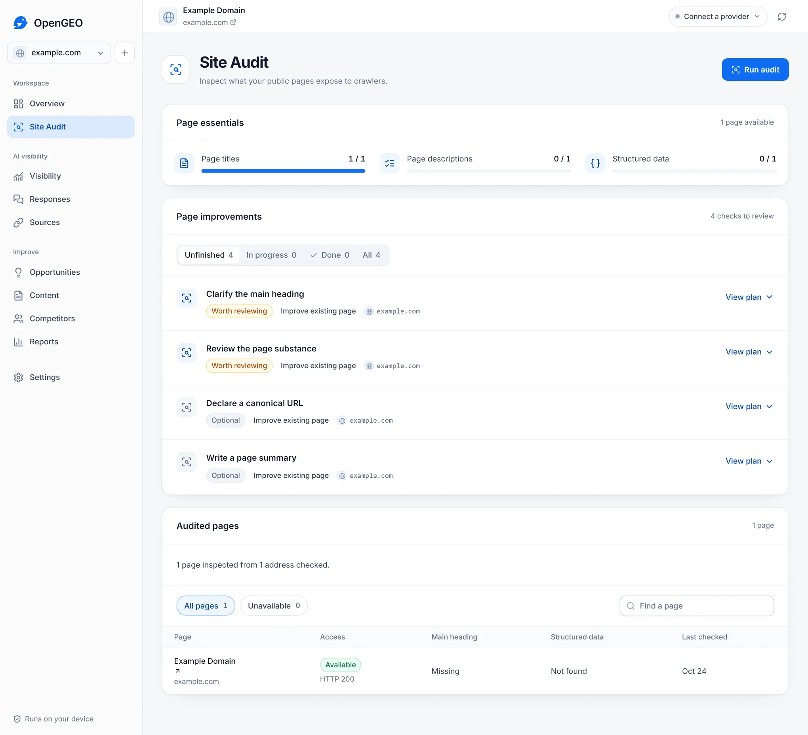

# OpenGEO

**Track your brand in AI answers. See what to improve next.**

OpenGEO is a free, open-source app for website owners and agencies. Find out whether AI answers mention your business, inspect the pages they cite, and work on your site's next improvement. Your projects, evidence and drafts stay in a workspace on your computer.

[Download for Windows or Mac](#download) | [Getting started](docs/getting-started.md) | [Connections](docs/connections.md) | [Self-hosting](docs/distribution.md#docker)

*A real local audit of example.com. No connected account or AI-generated results are used in this screenshot.*

## What you can do

- **Check your AI visibility.** Choose the questions your customers ask. See which answers mention your brand and which link to your website. Open the full answers and citations behind the numbers.
- **Audit your website.** Inspect titles, descriptions, headings, indexing instructions, canonical URLs and structured data. Start with a local audit before connecting an AI provider.
- **Find your next improvement.** Review suggested page updates, new resources and site changes alongside the evidence behind them.
- **Write with your sources in view.** Develop briefs and drafts from your pages and collected evidence. Keep the sources and factual review notes with each draft.
- **Check again after an update.** Repeat the same questions, model and locale, and compare the collected answers over time.
- **Manage several websites.** Keep separate projects, export your work and make backups. OpenGEO has no software-imposed project limit.

This work is often called generative engine optimization (GEO) or answer engine optimization (AEO). OpenGEO gives you a way to measure and work on it; it cannot promise a mention, citation or ranking.

## Download

The desktop app includes its runtime and browser. You do not need Node.js, Docker or an Apple developer account.

| Your computer | Download |
| --- | --- |
| Windows x64 | [Windows installer](https://github.com/surfacedby/OpenGEO/releases/download/v0.1.0-beta.3/OpenGEO-0.1.0-beta.3-windows-x64.exe) |
| Mac with an Apple M-series chip | [Apple Silicon DMG](https://github.com/surfacedby/OpenGEO/releases/download/v0.1.0-beta.3/OpenGEO-0.1.0-beta.3-macos-arm64.dmg) |
| Mac with an Intel processor | [Intel DMG](https://github.com/surfacedby/OpenGEO/releases/download/v0.1.0-beta.3/OpenGEO-0.1.0-beta.3-macos-x64.dmg) |

**This is a public beta.** Windows is unsigned; Mac downloads are ad hoc signed and not notarized. Your computer may show a warning or block installation. Both Mac versions were tested on macOS 15. Read the [installation guide](docs/distribution.md) for checksums, first-launch instructions and current limitations. Linux users can [run from source or use Docker](docs/distribution.md#docker).

## Your first session

1. Open the app and add your website. Choose **Use local audits only** if you want to try it without a connection.
2. Explore **Site Audit** to see what OpenGEO found on your public pages.
3. Connect an [eligible AI service](docs/connections.md), review your customer questions and run a visibility check.
4. Read **Responses** and **Sources**, then use **Opportunities** and **Content** to plan an update. Review a draft before publishing it.

*The audit checks what your pages expose to crawlers. AI visibility checks are a separate step.*

## Choose your connection

Use an eligible **ChatGPT subscription**, connect **OpenRouter**, or pair **DataForSEO with OpenRouter** for measurement, analysis and content. An optional **SurfacedBy API** connection offers the managed operations available on your server.

Local audits and project storage are free to use without a provider. Connected services have their own eligibility rules, limits and charges. OpenGEO asks for spending approval where required and never silently switches you to a paid provider. [Compare the connections](docs/connections.md).

## Your workspace stays yours

Projects and saved evidence live in local SQLite storage. Credentials are encrypted separately and excluded from project exports. Selected AI services receive the inputs needed for the work you request.

Optional usage sharing is preselected during setup. Uncheck it before finishing, or turn it off in **Settings > Data & privacy**. It shares activity counts, not your websites, prompts, answers or credentials. [Read the privacy details](docs/privacy.md).

## Guides and contributing

- [Getting started](docs/getting-started.md): from your first audit to a recheck.
- [Installation and self-hosting](docs/distribution.md): downloads, Docker, remote access, updates and backups.
- [Private access over Tailscale](docs/remote-access.md): server setup, workspace sign-in and connections from another device.
- [Connections and costs](docs/connections.md): choose a service and understand what it collects.
- [How measurements work](docs/methodology.md): mentions, citations, missing answers and comparisons.
- [Development](docs/development.md): run from source, use the CLI or connect MCP.

Found a bug or have an idea? [Open an issue](https://github.com/surfacedby/OpenGEO/issues). Contributions to the app, documentation and accessibility are welcome; see [CONTRIBUTING.md](CONTRIBUTING.md). Report vulnerabilities through the [security policy](SECURITY.md).

Maintained by [SurfacedBy](https://surfacedby.com). Original application code is [MIT licensed](LICENSE); bundled libraries keep their own [licenses and notices](THIRD_PARTY_NOTICES.md).
