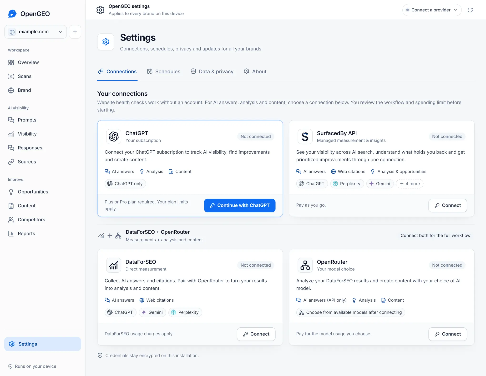

# Connections and costs

Start with the connection you already have. You can also use local audits and project storage without connecting any service.

| Connection | What it adds | What you need |
| --- | --- | --- |
| ChatGPT | API answer checks, analysis, question suggestions and content | An eligible subscription and the required account permissions. No separate API key; plan limits apply. |
| OpenRouter | API answer checks, analysis and content with a choice of models | An OpenRouter account with available credit. Connect with OAuth or an existing key. Model usage is billed by OpenRouter. |
| DataForSEO + OpenRouter | Consumer-interface answer collection, followed by AI analysis and content | Both accounts for the full workflow. Each provider charges for its usage. |
| SurfacedBy API | Managed checks and insights; suggestions, reviews and drafts when supported | An account with credit and a server that supports the requested operation. Availability is checked before it is offered. |

Open **Settings > Connections** to connect a service. Credentials are encrypted on your installation and excluded from project exports.

## ChatGPT

OpenGEO implements the [published subscription-sharing protocol](https://developers.openai.com/siwc/token-sharing-open-source/) independently. Eligibility, preview access and permissions can change; a ChatGPT account does not automatically guarantee access. The example DevKit is not bundled.

Checks collect Responses API answers. These can differ from the answers in the ChatGPT website or app. Web search depends on the selected model and account permissions. OpenGEO records whether a search was requested and whether the response confirms it ran.

When self-hosting in local mode, use a [local port forward](distribution.md#remote-access) so the sign-in browser can reach the callback on the OpenGEO host. Optional [private-network mode](remote-access.md#connect-ai-services) also supports pasting the exact one-time loopback redirect URL into the authenticated workspace. Do not expose an unprotected backend or share that URL to make sign-in work.

## OpenRouter

Choose a model after connecting. Answer checks use model-only API calls without a search plugin, so they do not reproduce a web-search session in a consumer chat app. Source links must come from the provider's answer evidence.

OpenRouter bills for the selected model. OpenGEO bounds output and estimates cost using model rates; rates can change. Review the approved ceiling before running work.

## DataForSEO with OpenRouter

DataForSEO collects supported AI-platform answers; OpenRouter handles analysis and content. Results keep their original collection surface, model and locale so you can judge what is comparable.

A direct DataForSEO request has no per-request dollar cap. Its actual charge can exceed an estimate. Use conservative estimates in OpenGEO and spending controls in the provider account.

## SurfacedBy API

SurfacedBy is optional. You can keep using local projects and exports without a managed account.

OpenGEO checks the connected server's capabilities before offering managed work. Supported checks show a credit preview or quote for review. Selected-question checks collect answers for the approved list without automatically purchasing analysis. Suggestions and drafts require a separate price review when available.

**Managed features are experimental in this beta.** The desktop release does not certify live supplier quality, billing and refund recovery, worker activation, usage delivery or historical imports. Availability depends on the connected service; see the [beta notes](releases/v0.1.0-beta.2.md).

## Spending, pauses and cancellation

OpenGEO never silently substitutes a paid provider. If access expires or a quota is reached, affected work pauses with its progress preserved. A reset time is shown only when the service supplies one.

A run budget controls whether another provider request starts. It cannot undo a charge already incurred. Completed paid work is retained. For managed operations, an approved maximum can be held until the final receipt confirms the charge and release of unused credit.

If a response is lost, OpenGEO checks the saved request identity before retrying. An uncertain paid request pauses for review rather than purchasing a replacement. Cancellation stops further local work and requests remote cancellation when supported; only a confirmed refund reduces the receipt. An unconfirmed cancellation remains unresolved.

Connected services receive the task inputs needed for the operation you request. Read [privacy and data handling](privacy.md) and each provider's own data policy before sending sensitive material.
